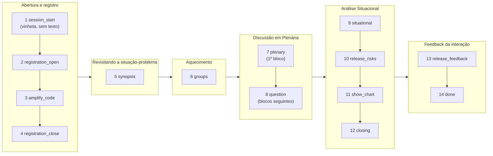

# O encontro, etapa por etapa

Este documento é a referência única da **Videoconferência Integrada**: a ordem das
etapas, o que entra em tela em cada uma, **na ordem em que entra**, e o que a sala
**fala** em voz alta. Serve para conduzir um encontro, para preencher o roteiro de um
episódio e para conferir se a sala está fazendo o que deveria.

## De onde vem cada coisa

O conteúdo do encontro tem três fontes, e confundi-las é a origem da maior parte das
dúvidas:

| o quê | onde vive | muda por episódio? |
|---|---|---|
| **Texto fixo** das seções (instruções de presença, dinâmica da plenária, critérios de risco) | **painel admin → Encontro** (tabela `encontro_template`; de fábrica, o que está no `schema.ts`) | **Não.** É igual em todo episódio de toda série |
| **Conteúdo variável** (sinopse, questões, riscos, títulos, banner) | roteiro do episódio, preenchido em *Gerenciar produção → Roteiro da Videoconferência* | **Sim** |
| **Tempo** de cada etapa, pausas e **a voz** | **painel admin → Encontro** | Não |
| **Ordem** das etapas | `backend/app/services/cadencia.py` (código) | Não |

> [!tip] O que se configura sem deploy, e o que não
> O painel ajusta **tempos, textos, pausas e voz**. A **ordem** das etapas não: ela está
> em três arquivos de código que não se importam, e mexer nela é mudança de produto com
> prova própria. Os temporizadores e a voz valem **na hora**, inclusive em sala já
> aberta; os textos entram no retrato da sala **na criação**.

O roteiro é **congelado na sala** no momento em que ela é criada. Editar o roteiro do
episódio depois disso não muda uma sala já criada — e é de propósito: um encontro não
deve mudar de conteúdo enquanto acontece.

Fonte original de tudo: *"(JD EP 5 e 6) VIDEOCONFERÊNCIA INTEGRADA (21jul26).docx"*. No
documento, **azul** = variável (virou campo), **preto** = fixo (virou bloco), **vermelho**
= episódio-modelo de referência (não entra no formulário; sobrou como *placeholder*).

## As 14 etapas

A sala avança sozinha quando a duração se esgota: ela pergunta à turma **"podemos
seguir?"** e dá 15 segundos. Avança com a **maioria estrita dos presentes** — e **quem
não vota conta como "não"**. Sem maioria, a etapa ganha **+2 min** e a pergunta volta.
As quatro primeiras etapas avançam **sem perguntar**: numa sala que ainda está enchendo,
perguntar é perguntar a quem não chegou, e a sala nunca sairia do lugar.

Em **modo manual** nada disso roda: só o ▶ do facilitador avança.

| # | etapa | título na tela | o que o ▶ faz | tempo (auto) | vota? |
|---:|---|---|---|---:|:---:|
| 1 | `session_start` | Abertura | Iniciar a sessão | 10 min | — |
| 2 | `registration_open` | Registro de Presença | Iniciar o registro | 5 min | — |
| 3 | `amplify_code` | Registro de Presença | Ampliar o código da sessão | 30 s | — |
| 4 | `registration_close` | Registro de Presença | Encerrar o registro | 30 s | — |
| 5 | `synopsis` | Situação-problema | Revisitar a situação-problema | 5 min | sim |
| 6 | `groups` | Aquecimento | Divisão em grupos | 15 min | sim |
| 7 | `plenary` | Discussão em Plenária | Discussão em plenária | 5 min | sim |
| 8 | `question` | Discussão em Plenária | Questões para reflexão | 7 min | sim |
| 9 | `situational` | Análise situacional | Análise situacional | 10 min | sim |
| 10 | `release_risks` | Análise situacional | Liberar análise individual de riscos | 10 min | sim |
| 11 | `show_chart` | Análise situacional | Mostrar gráfico | 5 min | sim |
| 12 | `closing` | Análise situacional | Encerramento | 3 min | sim |
| 13 | `release_feedback` | Feedback e encerramento | Liberar feedback de interação | 10 min | sim |
| 14 | `done` | Encerramento | Encerrar a sala | — | — |

**Soma dos tempos: 86 minutos**, mais o que a turma demorar nos votos. É a tabela de
`DURACAO_DA_ETAPA` — valores de produto: quem for ajustar o ritmo mexe ali.

### As etapas compartilham seções do roteiro

Catorze etapas, seis seções. É isto que explica por que uma etapa não tem texto próprio:

A seção **Discussão em Plenária** é a única **repartida**: o 1º bloco (o objetivo da
discussão) abre a plenária, e os seguintes — que descrevem a dinâmica das questões —
pertencem à tela "Questões para reflexão". As etapas 11 e 12 (`show_chart`, `closing`)
não têm texto: a tela delas é o **gráfico**.

---

# Etapa por etapa

Em cada etapa abaixo, a ordem dos itens é a ordem em que eles aparecem na tela — e a
ordem em que a voz os lê. **Títulos de bloco** ("Registro de Presença", "Importante!")
aparecem na tela mas **não são falados**: são rótulos, não instrução.

O fundo das telas de texto e de cascata é o **banner do episódio** (campo `bannerFundo`).
As telas de **gráfico** (etapas 10 a 12) têm fundo próprio.

## 1 · Abertura — `session_start`

**Tela (só o facilitador):** a vinheta da série, montada com os campos do episódio nesta
ordem: assinatura da série, série e temporada, título do episódio, aviso de direitos.

> SÉRIE ORIGINAL JOHN DEERE
> Série: "Técnico de Serviços" | Temporada 1: "Transforme seu Atendimento"
> T1:E5 "Na dúvida, o prejuízo vem"
> @todos os direitos reservados

**O aluno vê a área de apresentação vazia** até o facilitador iniciar a sessão.

**Voz:** nenhuma. A vinheta é identidade da série, não instrução.

**Ao avançar:** inicia a aula OpenPBL (cria a chamada e o class code).

## 2 · Registro de Presença — `registration_open`

**Tela (todos):** os dois blocos fixos da seção de abertura, nesta ordem.

> **Registro de Presença**
> Aponte o smartphone para o QR Code na tela para acessar a aplicação deste encontro.
> Para registrar a sua presença, digite o class code no chat de interação da aplicação.

> **Importante!**
> Caso o participante não disponha de um smartphone ou de acesso à internet, NÃO será possível a sua interação com os demais participantes.
> Neste caso, somente poderá acompanhar as atividades do encontro como "participante ouvinte".

**Voz:** os **4 parágrafos acima**, na ordem.

O class code aparece no cabeçalho do facilitador da **etapa seguinte** em diante (ele só
existe depois de a aula começar), e para o aluno enquanto o registro estiver aberto — o
facilitador pode ocultá-lo só para a turma, pelo ícone de olho.

## 3 · Ampliar o código da sessão — `amplify_code`

**Tela (todos):** a **mesma** da etapa 2, com o **class code em letras grandes** por
cima. Existe para quem chegou atrasado entrar antes de o registro fechar. O popup abre
em cada participante ao entrar na etapa e fecha ao sair dela.

**Voz:** nenhuma — o texto é o mesmo da etapa anterior, e reler por cima de si mesmo
soa como defeito. Quem quiser que a sala releia usa o **↻ Repetir**.

## 4 · Encerrar o registro — `registration_close`

**Tela:** ainda a da seção de abertura.

**Voz:** nenhuma (mesmo texto da etapa 2).

**Ao avançar:** fecha a chamada e **divide os grupos**.

## 5 · Situação-problema — `synopsis`

**Tela (todos):** a sinopse do episódio em **dois cards sequenciais**, revelados um a um
pelo facilitador, sob o rótulo "Revisitando a situação-problema" (com o contador 1/2,
2/2). Esta seção **não tem texto fixo**.

| ordem | campo |
|---|---|
| card 1/2 | `sinopseParte1` — apresenta a situação-problema |
| card 2/2 | `sinopseParte2` — desfecho e consequência da decisão |

**Voz:** **cada card, no momento em que é revelado** — e só ele. Não antes: a sala
entregaria o desfecho antes da pergunta.

## 6 · Aquecimento — `groups`

**Tela (todos):** o bloco fixo, e abaixo as **questões orientadoras** reveladas uma a uma.

> Os participantes serão divididos em grupos de até 5 integrantes para ouvirem as propostas sugeridas por seus pares e refletirem sobre seus argumentos.
> Estabeleçam uma sequência de exposições, até que todos tenham oportunidade de apresentar seus pontos de vista.

Depois, cascata "Questões orientadoras" — `questoesOrientadoras`, **3 questões** previstas
no roteiro (ação, consequência, prevenção).

**Voz:** os 2 parágrafos fixos ao abrir a etapa, e **cada questão ao ser revelada**.

**Ao avançar:** reveladas todas as questões, o clique seguinte **abre as salas de grupo**
(10 min) — e **não** troca de etapa: dentro do grupo a turma discute com as questões em
tela. O clique seguinte encerra os grupos e só então segue para a plenária.

Enquanto os grupos estão abertos, o facilitador **não vê a apresentação** — vê os grupos.

## 7 · Discussão em Plenária — `plenary`

**Tela (todos):** o **1º bloco** da seção, e abaixo o card "Relembrando o episódio".

> O objetivo da discussão em plenária é a apresentação e a contra argumentação das ideias relativas à situação-problema abordada no episódio.
> Os participantes do encontro devem postar-se de tal forma que, cada participante possa interagir com todos os demais.

> **Relembrando o episódio**
> *(campo `relembrandoEpisodio` — recorte da sinopse focado no conflito que será discutido)*

**Voz:** os 2 parágrafos fixos e, em seguida, o card "Relembrando o episódio".

**Ao avançar:** se os grupos ainda estiverem abertos, todos voltam à sala principal.

## 8 · Questões para reflexão — `question`

**Tela (todos):** os blocos **seguintes** da seção da plenária, como introdução da
cascata, e as questões reveladas uma a uma.

> A dinâmica das discussões será orientada por uma sequência de questões.
> Cada questão deverá ser dirigida à um participante, cuja resposta servirá de argumentação base para observações posteriores dos demais participantes.

Depois, cascata "Questões para reflexão" — `questoesPlenaria`, **5 questões** previstas.
O facilitador revela; o aluno recebe exatamente a mesma cascata (por dados do LiveKit,
reenviada a cada 3 s para quem entra no meio).

**Voz:** os 2 parágrafos da dinâmica ao abrir a etapa, e **cada questão ao ser revelada**.

**A gravação começa aqui**, na primeira questão.

**Ao avançar:** revelada a última questão, a sala vai para a Análise situacional.

## 9 · Análise situacional — `situational`

**Tela (todos):** a cascata dos **riscos a avaliar**, sob o rótulo "Principais riscos" —
`riscos`, **5 riscos** previstos, revelados um a um.

**Voz:** ao abrir a etapa, os textos fixos da Análise Situacional (7 falas, na ordem):

> Cada participante irá sintetizar a sua análise sobre as possíveis ações diante da situação-problema abordada no episódio.
> Considere os argumentos apresentados por seus pares de profissão na discussão plenária além de suas próprias reflexões.

> Os participantes deverão avaliar os principais riscos envolvidos nas possíveis ações discutidas no encontro.
> Serão questionados, separadamente, os critérios de:

> - Probabilidade (chances do risco avaliado ocorrer)
> - Impacto (consequência resultante, caso o risco avaliado ocorra)

> A seguir, os cinco principais riscos abordados na discussão em plenária que deverão ser avaliados pelos participantes.

E depois **cada risco ao ser revelado**.

> [!note] O texto anuncia **cinco** riscos
> Mantenha a quantidade do campo `riscos` alinhada com isso, ou a sala anuncia cinco e
> mostra outro número.

**Ao avançar:** revelado o último risco, o clique **já libera o questionário de riscos**
no celular dos participantes e entra na etapa seguinte.

## 10 · Liberar análise individual de riscos — `release_risks`

Aqui a tela **difere por papel**, porque a atividade difere:

- **facilitador e moderador:** o **gráfico radar**, com a contagem de quem ainda não
  respondeu. Pode ser ocultado pelo botão "Ocultar gráfico".
- **aluno:** o texto da Análise situacional — ele está respondendo no celular.

**Voz:** nenhuma (mesmo texto da etapa 9, já falado).

## 11 · Mostrar gráfico — `show_chart`

**Tela (todos):** o **gráfico radar**. Ele entra **zerado** para a turma: o facilitador
vai habilitando série por série na legenda, e o filtro dele replica na tela de todos.

**Voz:** nenhuma — a tela é o gráfico, não um texto do roteiro.

## 12 · Encerramento — `closing`

**Tela:** o gráfico.

**Voz:** nenhuma.

**Ao avançar:** **para a gravação** e **libera as percepções** (o feedback de interação)
no celular dos participantes.

## 13 · Feedback da interação — `release_feedback`

**Tela (todos):** tela própria da etapa — o gráfico sai de cena, porque a atividade agora
é outra. Leva o título da seção, e abaixo os dois blocos:

> Uma equipe de desempenho superior é composta por profissionais com habilidades complementares.
> Portanto, saber em quais habilidades nos destacamos é uma informação chave para a busca de um desempenho profissional de excelência.
> Nesta atividade, os participantes deverão compartilhar suas percepções sobre a interação com os integrantes do seu grupo.

> **Importante!**
> Este exercício não identifica ou registra opiniões isoladas.

**Voz:** os **4 parágrafos acima**.

## 14 · Encerrar a sala — `done`

**Tela:** a mesma da etapa 13.

**Voz:** nenhuma (mesmo texto).

**O ▶ aqui não avança:** abre a confirmação de **encerrar a sala para todos**. É a última
tarefa do sequenciador.

---

# O roteiro do episódio: o que preencher

Os campos abaixo são tudo o que varia por episódio. Os obrigatórios estão marcados.

## Abertura e registro

| campo | tipo | obrigatório | aparece em |
|---|---|:---:|---|
| `serieTemporada` | texto | ✔ | etapa 1 (vinheta) |
| `tituloEpisodio` | texto | ✔ | etapa 1 (vinheta) |
| `marcaSerie` | texto | | etapa 1 (vinheta) |
| `direitos` | texto | | etapa 1 (vinheta) |
| `bannerFundo` | imagem | | **fundo de todas as etapas** (paisagem, ex. 1920×1080) |

## Revisitando a situação-problema

| campo | tipo | obrigatório | aparece em |
|---|---|:---:|---|
| `sinopseParte1` | textarea | ✔ | etapa 5, card 1/2 |
| `sinopseParte2` | textarea | ✔ | etapa 5, card 2/2 |
| `curadoria` | lista | | *só no episódio-modelo do docx* |
| `tarefaTecnica` | texto | | *só no episódio-modelo* |
| `dificuldadeNaoTecnica` | texto | | *só no episódio-modelo* |

## Aquecimento

| campo | tipo | obrigatório | aparece em |
|---|---|:---:|---|
| `questoesOrientadoras` | lista, **3 itens** | ✔ | etapa 6, cascata |

## Discussão em Plenária

| campo | tipo | obrigatório | aparece em |
|---|---|:---:|---|
| `relembrandoEpisodio` | textarea | ✔ | etapa 7, card único |
| `questoesPlenaria` | lista, **5 itens** | ✔ | etapa 8, cascata |

## Análise Situacional

| campo | tipo | obrigatório | aparece em |
|---|---|:---:|---|
| `riscos` | lista, **5 itens** | ✔ | etapa 9, cascata — e são as dimensões do gráfico |

## Feedback da interação

Nenhum campo: a seção é só texto fixo.

---

# A voz da sala

A sala **lê em voz alta** o que o facilitador humano leria. Não é faixa publicada no
LiveKit: cada participante ouve pelo **próprio dispositivo**, então o encontro não
depende de haver um agente de voz de pé.

**O que ela fala, e quando:**

| momento | o que lê |
|---|---|
| ao abrir uma etapa | o texto fixo da etapa — **se for diferente** do que acabou de ler |
| ao revelar um card | **só o card que entrou** |

Entre um parágrafo e o seguinte ela espera a **pausa** configurada para aquele parágrafo
(painel admin → Encontro). A pausa é um número, não silêncio sintetizado: ajustá-la não
refaz áudio nenhum. Depois de um parágrafo que **não** tocou (voz ainda não sintetizada,
ou aba sem gesto do usuário) a pausa **não** é esperada — silêncio no lugar de uma frase
que não foi dita seria o dobro do problema.

Nunca lê: títulos de bloco, a vinheta da série, o campo `bannerFundo` (é chave de
imagem — a sala diria "banner barra ep5 ponto png"), nem a tela do gráfico.

**Controle, só de quem dirige** (canto da apresentação):

- **🔊 / 🔇** silencia e religa a voz. Existe porque o áudio automático pode começar em
  cima de alguém que já estava falando.
- **↻ Repetir** relê a etapa **inteira** — os textos fixos mais os cards já revelados. É
  o "não ouvi, repete", e é também como se faz a sala reler as instruções de presença na
  etapa 3.

A **aba espelho do grupo** fica muda: é a mesma pessoa entrando duas vezes, e ouviria
tudo em dobro, defasado.

**Quando não há voz, não há erro:** a tela mostra o texto e o encontro segue. Um encontro
sem voz é um encontro; um encontro travado esperando o sintetizador não é.

## Como o áudio existe

O mp3 de um texto é gravado num endereço que é o **hash do texto mais a voz**. Disso saem
três coisas de graça:

- a **primeira sala** de um episódio paga a síntese; as seguintes não pedem nada — e os
  textos fixos são pagos **uma única vez na vida**, porque são iguais em todo episódio;
- **mudar uma palavra** no roteiro gera um endereço novo: o áudio velho nunca é servido
  com o texto novo (a sala dizendo uma coisa e a tela mostrando outra é o defeito
  realmente perigoso aqui);
- **nada é gravado no banco**: o endereço se recalcula do texto a cada carga da sala.

- e **trocar a voz** também gera endereços novos, em vez de servir o áudio da voz
  anterior para sempre. Voltar para a voz antiga reaproveita o que já existe.

A síntese acontece **ao criar a sala**, em segundo plano. Se falhar, o host tem uma rota
para refazer só o que falta — e o painel admin tem o botão
`⚡ Sintetizar todo o texto fixo`, que é o que se usa **depois de trocar a voz ou editar
texto**: sem ele, a conta da síntese cai na primeira sala criada em seguida.

---

# Limites conhecidos

> [!warning] Em modo automático as cascatas não avançam sozinhas
> Revelar card (sinopse, questões orientadoras, questões da plenária, riscos) é sempre um
> **clique do facilitador**. A cadência avança de **etapa**, não de card. Sem ninguém
> conduzindo, cada etapa em cascata mostra **só o primeiro card** e depois passa. É por
> isso que as primeiras execuções pedem supervisão.

> [!note] O aluno não vê a abertura
> Em `session_start` a área de apresentação do aluno fica vazia de propósito. A vinheta é
> do facilitador.

> [!note] Um encontro, duas gravações
> A gravação começa na primeira questão da plenária (etapa 8) e termina no encerramento
> (etapa 12). Fora desse intervalo não há gravação.

# Onde mexer

| para mudar | onde |
|---|---|
| a duração de uma etapa | **painel admin → Encontro** |
| quanto da turma precisa dizer "sim", a janela do voto, a tolerância | **painel admin → Encontro** |
| o texto fixo de uma seção, e a pausa depois de cada parágrafo | **painel admin → Encontro** |
| a voz que lê (Polly ou ElevenLabs, e qual voz) | **painel admin → Encontro** — e depois `⚡ Sintetizar todo o texto fixo`, senão a primeira sala criada é que espera |
| o padrão de fábrica dos tempos | `cadencia.py` (`DURACAO_DA_ETAPA`, `LIMIAR_DE_AVANCO`) — vale para quem nunca configurou |
| o padrão de fábrica dos textos | `encontro.py` (`SECOES_BASE`); o `schema.ts` do CustomerApp segue alimentando o formulário do curador, mas o que a sala mostra vem do template |
| a ordem das etapas | `cadencia.py` (`ORDEM`), `openpbl_class.py` (`_STAGES`) **e** `VideoRoom.tsx` (`STEPS`) — as três, sempre, mais `encontro.CATALOGO` |
| que seção aparece em que etapa | `VideoRoom.tsx` (`secaoDaEtapa`) **e** `encontro.CATALOGO` — a voz e o painel seguem junto |

> [!important] A tela de configuração é a quarta leitura da lista de etapas
> `encontro.CATALOGO` deriva a ordem de `cadencia.ORDEM`, mas repete título, ação e seção
> de cada etapa — porque o backend não lê o frontend.
> `backend/provas/prova_template_do_encontro.py` compara os três (`STEPS`, `secaoDaEtapa`,
> `CATALOGO`) e falha se qualquer um divergir. Divergir aqui faz o painel prometer uma
> ação que o ▶ não executa, ou configurar a duração de uma etapa que não existe.

> [!important] A ordem das etapas vive em **três** arquivos
> Nenhum importa o outro, e divergirem **não dá erro**: a sala entra numa etapa que a
> tela não reconhece, a tela cai para "Abertura" e o facilitador vê o encontro no lugar
> errado. Já aconteceu. `backend/provas/prova_cadencia.py` compara as três listas e
> confere que toda etapa da tela tem ação no sequenciador —
> `python -B provas/prova_cadencia.py`.
