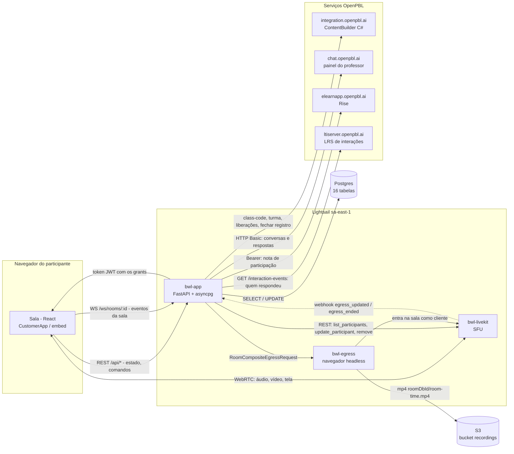
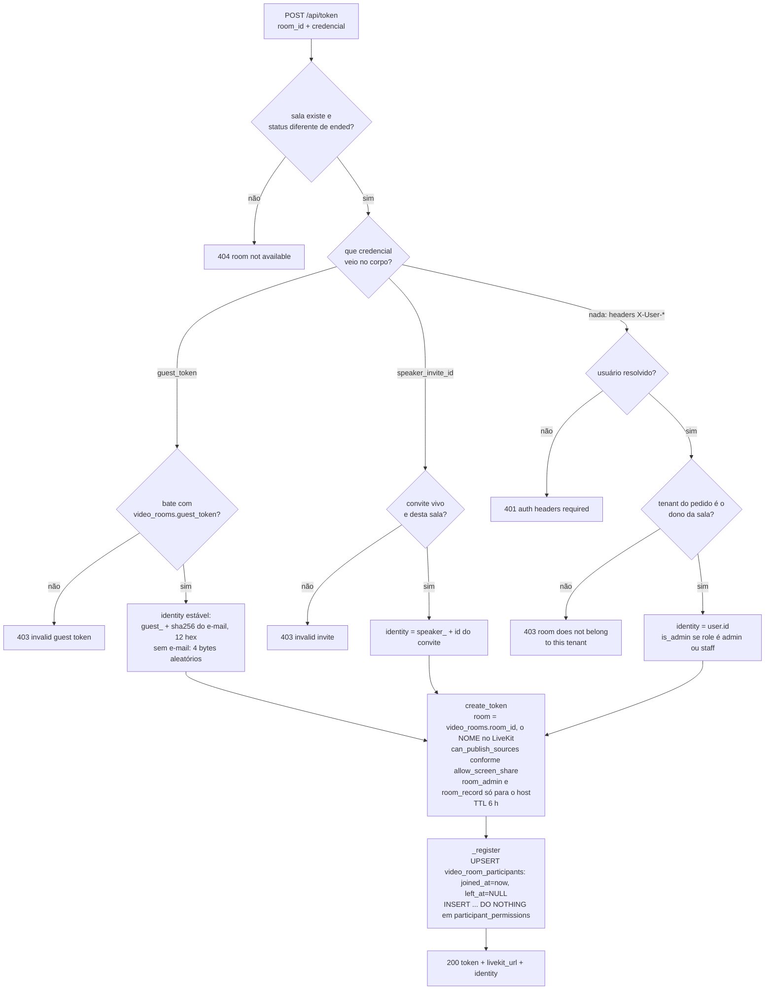
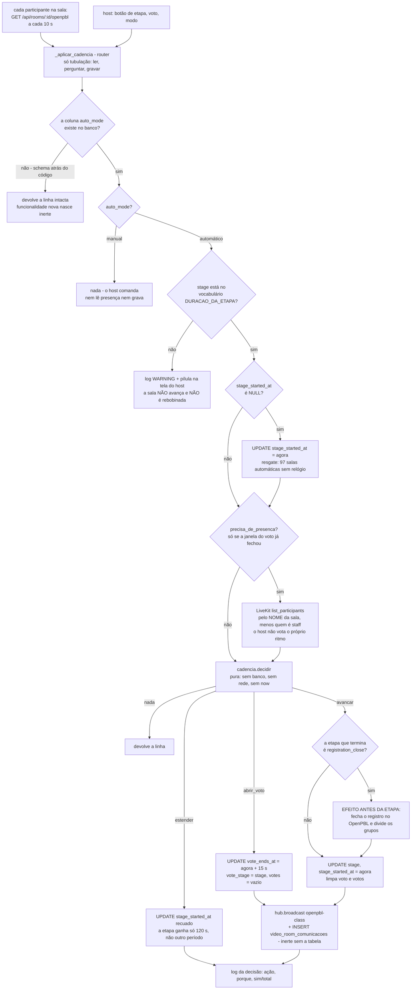
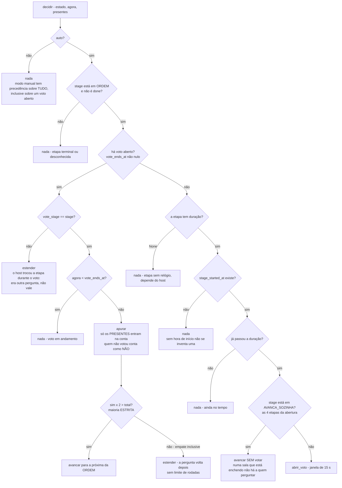
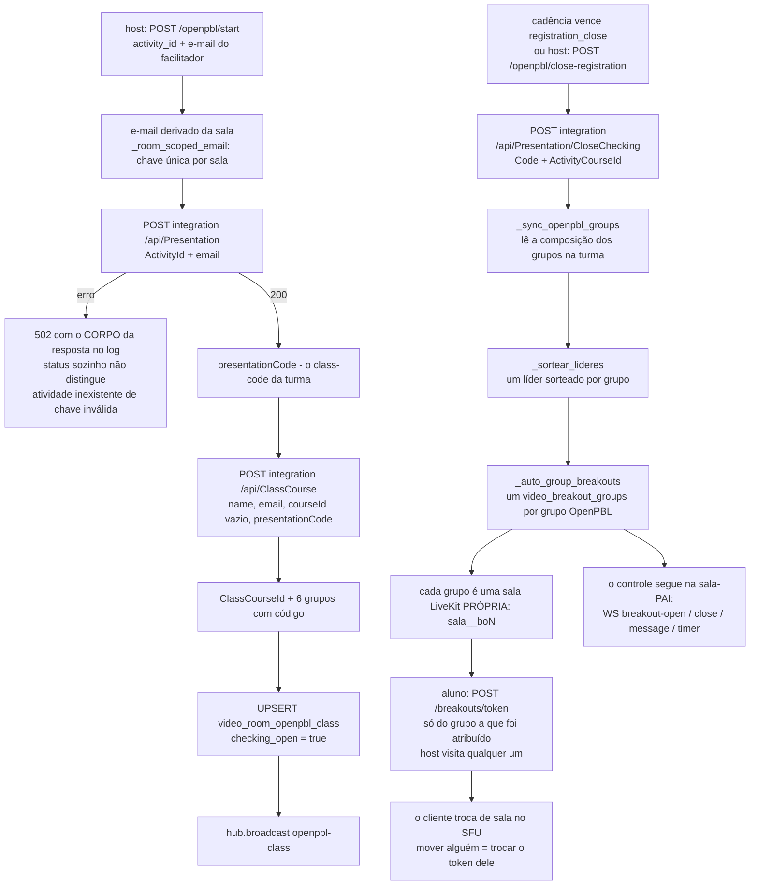
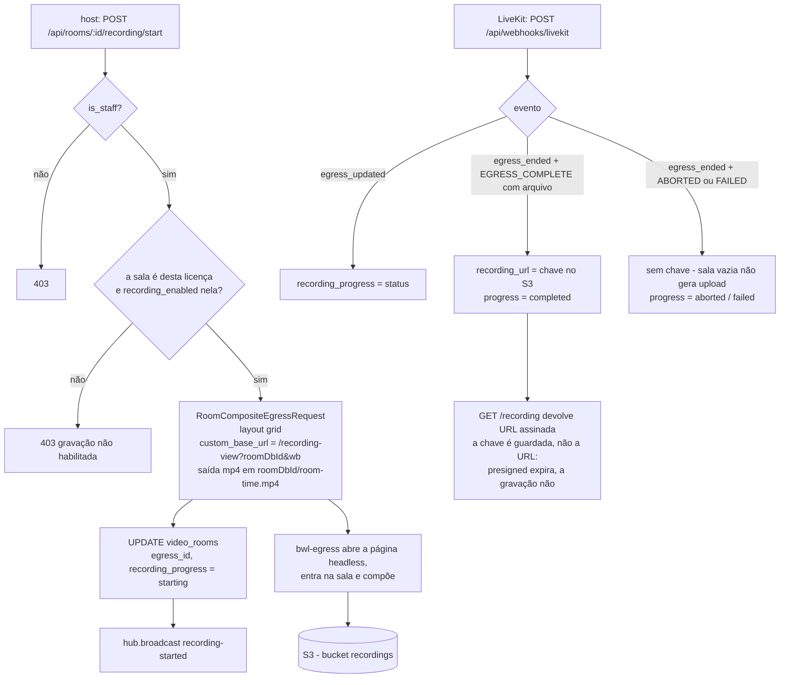

# Backend da VideoConference BWL - diagramas

Cole cada bloco no app **Diagram as code / Mermaid** do Miro.
Gerado de `videoconf-backend.html` por `extrair_mermaid.py`.

## esquema 01 · componentes e fronteiras

## esquema 02 · POST /api/token

## esquema 03 · tubulação da cadência

## esquema 04 · cadencia.decidir

## esquema 05 · a espinha do encontro

```mermaid
flowchart LR
  subgraph AB["abertura - avança sozinha, sem voto"]
    direction LR
    A1["session_start<br/>10 min"] --> A2["registration_open<br/>5 min"] --> A3["amplify_code<br/>30 s"] --> A4["registration_close<br/>30 s"]
  end

  subgraph CO["o encontro - cada passagem é votada pela turma"]
    direction LR
    B1["synopsis<br/>5 min"] --> B2["groups<br/>15 min"] --> B3["plenary<br/>5 min"] --> B4["question<br/>7 min"] --> B5["situational<br/>10 min"]
    B5 --> B6["release_risks<br/>10 min"] --> B7["show_chart<br/>5 min"] --> B8["closing<br/>3 min"] --> B9["release_feedback<br/>10 min"]
  end

  A4 -->|"fecha o registro e divide os grupos"| B1
  B9 --> D["done<br/>sem relógio"]
```

## esquema 06 · abrir a aula, fechar o registro, abrir os grupos

## esquema 07 · egress e o webhook

